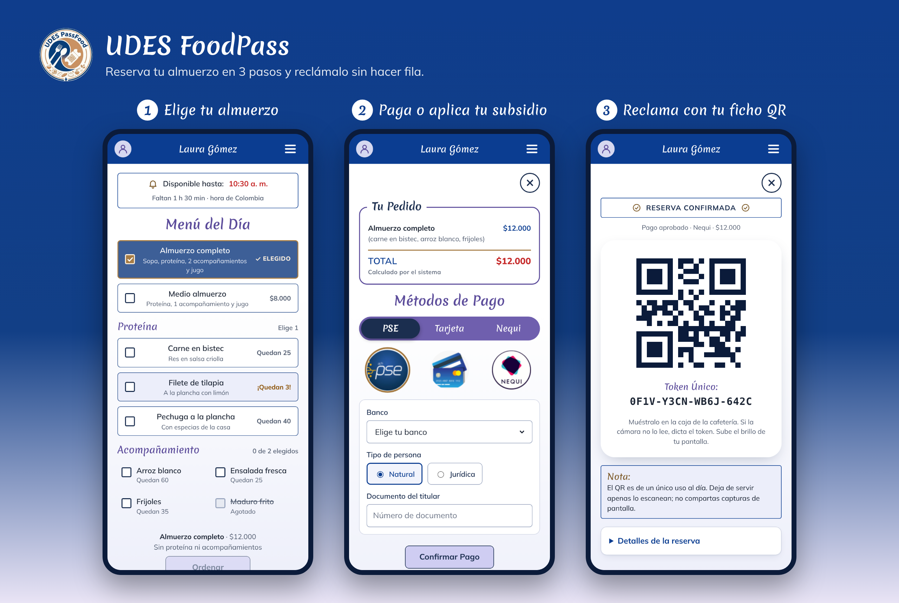

# UDES FoodPass

Plataforma web responsiva para **reservar y reclamar almuerzos** en la cafetería principal de la Universidad de Santander (UDES, zona de buses), con **ficho digital QR**.

Proyecto de aula de **Diseño de Software I**, Ingeniería de Software.

> **Estado:** las fases 0 a 5 están completas. Hay base de datos, API, interfaz del usuario y del administrador, con pruebas automáticas y verificación en el navegador. Los pagos funcionan en **entorno de pruebas (sandbox)**: no se mueve dinero real.

## ¿Qué problema resuelve?

A la hora del almuerzo se forman filas largas para comprar y reclamar los fichos, y no se puede reservar con anticipación. Los estudiantes con subsidio hacen fila dos veces.

Con UDES FoodPass, desde el celular, puedes:
1. Ver el menú del día y cuántas porciones quedan.
2. Elegir tu almuerzo y pagarlo en línea (Nequi, PSE o tarjeta), o aplicar tu subsidio.
3. Recibir un **ficho QR de uso único** y reclamar tu almuerzo sin hacer fila.

El administrador gestiona el menú, las porciones y los horarios. En la entrega escanea el QR, que ya no puede usarse otra vez.



## Tecnologías

| Capa | Tecnología |
|---|---|
| Frontend | React + Vite (JavaScript), mobile-first; `html5-qrcode` para leer el QR |
| Backend | Node.js 22 + Express 5, módulos ES; `zod`, `bcrypt`, JWT, `qrcode` |
| Datos | PostgreSQL 16 (con Docker Compose), migraciones SQL con `pg` |
| Pruebas | Vitest + Supertest contra una base de datos de pruebas real |

Arquitectura en capas con cuatro módulos: **Autenticación**, **Gestión de Menú**, **Reservas y Pagos** (con el patrón Strategy para los medios de pago) y **Validación QR**. Cada módulo es dueño de sus tablas y los demás solo usan sus operaciones.

## Requisitos

| Programa | Para qué | Cómo ver si lo tienes |
|---|---|---|
| git | Descargar el código | `git --version` |
| Node.js 22 o superior (trae npm) | Ejecutar el backend y el frontend | `node --version` |
| Docker + Docker Compose | Ejecutar PostgreSQL sin instalarlo en el sistema | `docker --version` y `docker compose version` |

> **En Arch Linux**, Docker necesita que su servicio esté encendido. Si `docker compose up -d` dice *Cannot connect to the Docker daemon*, el servicio está apagado. Encenderlo usa `sudo` y modifica el sistema: pide ayuda antes de hacerlo si no estás seguro.

## Instalación (una sola vez)

Todos los comandos se escriben en una terminal abierta **dentro de la carpeta del proyecto**.

```bash
# 1. Descargar el proyecto
git clone https://github.com/EDER1002/UDES-FoodPass.git
cd UDES-FoodPass

# 2. Crear tu configuración local
cp .env.example .env
```

Abre `.env` con un editor de texto y cambia cada `cambia_esto`:
- `POSTGRES_PASSWORD`: inventa una contraseña y escríbela también dentro de `DATABASE_URL` y `DATABASE_URL_TEST`.
- `JWT_SECRETO`: al menos 32 caracteres cualesquiera.
- `WEBHOOK_SECRETO`: al menos 16 caracteres cualesquiera.

```bash
# 3. Encender la base de datos (queda en un contenedor, no se instala en el sistema)
npm run db:levantar

# 4. Instalar dependencias (todo queda en la carpeta node_modules del proyecto)
npm install

# 5. Crear las tablas y cargar los datos de ejemplo
npm run db:migrar
npm run db:seed
```

## Uso diario

```bash
npm run db:levantar   # enciende PostgreSQL (si no está encendido)
npm run dev           # arranca la API y la interfaz juntas
```

Abre **http://localhost:5173** en el navegador. Para detener todo: `Ctrl + C` en la terminal y luego `npm run db:apagar`.

| Comando | Qué hace |
|---|---|
| `npm run dev` | API (`http://localhost:3000/api`) e interfaz (`http://localhost:5173`) juntas |
| `npm run dev:backend` / `npm run dev:frontend` | Cada una por separado, en terminales distintas |
| `npm run dev:celular` | Igual que `dev`, pero con HTTPS para usar la cámara del celular (ver abajo) |
| `npm test` | Pruebas automáticas del backend (128 pruebas) |
| `npm run prueba:navegador` | Prueba completa en el navegador: recorre la aplicación como lo haría una persona (30 casos, ver abajo) |
| `npm run diseno:capturas` | Vuelve a tomar los mockups de `docs/diseno/mockups/` desde la aplicación real |
| `npm run build` | Compila la interfaz para producción en `frontend/dist/` |
| `npm run db:seed` | **Borra todo** y vuelve a cargar los datos de ejemplo (útil para empezar de cero) |
| `npm run pago:webhook` | Simula la respuesta del banco a un pago PSE pendiente (ver abajo) |
| `npm run db:apagar` | Apaga PostgreSQL (los datos se conservan) |

## Usuarios de prueba

Son **datos de ejemplo, solo para desarrollo**. La contraseña de todos es **`FoodPass2026!`**.

| Correo | Nombre | Rol | Para probar |
|---|---|---|---|
| `estudiante.regular@udes.edu.co` | Laura Gómez | Estudiante regular | Reserva y pago en línea |
| `estudiante.subsidiado@udes.edu.co` | Andrés Rincón | Estudiante subsidiado | Reserva sin pago (total $0) |
| `subsidiado.sin.beneficio@udes.edu.co` | Valentina Díaz | Estudiante subsidiado | Pantalla "Tu subsidio no está disponible" (beneficio vencido) |
| `empleado@udes.edu.co` | Diana Ruiz | Empleado UDES | Igual que el estudiante regular |
| `admin@udes.edu.co` | Carlos Pérez | Administrador | Menú, catálogos, horarios, validación de fichos, entregas y solicitudes de cuenta |
| `nueva.subsidiada@udes.edu.co` | Sofía Méndez | Estudiante subsidiado | Cuenta **en revisión**: no puede entrar hasta que el administrador la apruebe en **Solicitudes** |
| `nuevo.profesor@udes.edu.co` | Jorge Castro | Empleado UDES | Cuenta **en revisión** |

**Crear cuenta:** cualquiera puede registrarse desde "Registrarse" con un correo `@udes.edu.co`. El estudiante regular queda activo de una vez; el subsidiado, el empleado y el administrador quedan en revisión hasta que un administrador los apruebe (o los rechace con un motivo, que la persona ve al intentar entrar).

**¿Olvidaste tu contraseña?** En el inicio de sesión hay un enlace para recuperarla:

- **Por correo:** llega un código de 6 dígitos que vence en 15 minutos. Para que el correo salga de verdad, llena las variables `SMTP_*` de tu `.env` (ver `.env.example`; con Gmail necesitas una "clave de aplicación"). **Sin SMTP**, mientras desarrollas, el correo con el código aparece en la terminal donde corre la API (`npm run dev`).
- **Con ayuda del administrador:** si el correo no llega, la persona pide ayuda con su correo y documento. El administrador la ve en **Solicitudes → Recuperar contraseña**, revisa su documento en persona y genera un código (vence en 60 minutos).

**Ayuda y asistente:** la página **Ayuda** (menú del usuario, panel del administrador o enlace en el inicio de sesión) tiene las preguntas frecuentes con buscador. Con sesión iniciada aparece también el **Asistente FoodPass**, un chat que responde el menú de hoy, la hora límite, el estado de tu reserva y las preguntas frecuentes. No usa IA externa ni necesita llaves.

El seed publica un menú para hoy y los próximos 13 días, con horario de reserva de 00:00 a 23:59 para que puedas probar a cualquier hora. "Maduro frito" empieza **agotado** y "Filete de tilapia" tiene solo 3 porciones, para ver esos estados.

## Datos de prueba de los pagos

La pantalla de pago tiene un enlace **"Ver datos de prueba"** con esta misma información.

| Medio | Datos | Resultado |
|---|---|---|
| Tarjeta | `4242 4242 4242 4242`, cualquier vencimiento futuro (ej. `12/30`) y CVC de 3 dígitos | Aprobado |
| Tarjeta | `4111 1111 1111 1111` | Rechazado (fondos insuficientes) |
| Nequi | Cualquier celular de 10 dígitos que empiece por 3 (ej. `3001234567`) | Aprobado |
| Nequi | `3992222222` | Rechazado |
| PSE | Banco "aprueba el pago" | Aprobado |
| PSE | Banco "rechaza el pago" | Rechazado |
| PSE | Banco "respuesta pendiente" | Queda **pendiente** hasta que llegue la respuesta del banco |

**Pago pendiente (PSE):** la pantalla queda en "Tu banco está procesando el pago". Para simular la respuesta del banco, abre **otra terminal** en la carpeta del proyecto y escribe:

```bash
npm run pago:webhook               # aprueba el pago pendiente más reciente
npm run pago:webhook -- RECHAZADO  # o lo rechaza
```

La pantalla del usuario cambia sola en unos segundos. Por dentro, el comando envía a `POST /api/pagos/webhook` la notificación firmada (HMAC-SHA256 con `WEBHOOK_SECRETO`) que mandaría una pasarela real.

**Reintentos seguros:** cada intento de pago lleva una `Idempotency-Key`. Si se repite (doble clic, se cayó la conexión), el sistema devuelve el mismo resultado sin cobrar dos veces.

### Usar Wompi en vez del sandbox (opcional)

Por defecto los pagos son simulados (`PASARELA_MODO=sandbox`) y no necesitas nada más. Para probar con el **ambiente de pruebas de Wompi** (tampoco mueve dinero real):

1. Crea una cuenta de comercio en Wompi y copia, desde su panel (*Desarrolladores*), las llaves de **pruebas**: pública (`pub_test_…`), privada (`prv_test_…`), secreto de integridad y secreto de eventos.
2. En tu `.env`, cambia `PASARELA_MODO=wompi` y llena las variables `WOMPI_*` (están explicadas en `.env.example`).
3. En el panel de Wompi, pon como **URL de eventos** `https://<tu-servidor>/api/pagos/webhook/wompi`. Wompi necesita una dirección pública para avisar el resultado de Nequi y PSE.

Los datos de prueba de Wompi son casi los mismos de la tabla de arriba; la diferencia es Nequi: `3991111111` aprueba y `3992222222` rechaza. Con Wompi, los reembolsos (cuando se agota un plato o se cancela una reserva pagada) se hacen a mano desde el panel de Wompi. Más detalles en [`docs/pasarela-de-pago.md`](docs/pasarela-de-pago.md).

## Probar el escáner de QR con el celular

El navegador del celular solo permite usar la cámara en páginas con HTTPS.

1. Conecta el computador y el celular a la **misma red Wi-Fi**.
2. Ejecuta `npm run dev:celular`. Vite muestra una dirección como `https://192.168.1.20:5173` (la línea *Network*).
3. Abre esa dirección en el celular. Saldrá un aviso de "conexión no privada" porque el certificado es de desarrollo: elige *Avanzado → Continuar*.
4. Ingresa como `admin@udes.edu.co`, entra a **Validar fichos** y pulsa **Activar cámara**.

Si la cámara no está disponible, el administrador puede **escribir el token** del ficho (no importan las mayúsculas ni los guiones).

## Prueba completa en el navegador

`npm run prueba:navegador` abre un Chromium invisible y usa la aplicación como lo haría una persona: inicia sesión, elige el almuerzo, paga con los tres medios, recibe el QR y, como administrador, aprueba cuentas y valida fichos (también con una cámara simulada que "ve" el QR). En cada pantalla revisa la accesibilidad (WCAG 2.2 AA, con axe-core) y que no haya errores en la consola.

- **No toca tus datos:** usa la base de pruebas (`DATABASE_URL_TEST`) y arranca su propia API (puerto 3100) e interfaz (puerto 5174), así que puede correr aunque tengas `npm run dev` abierto. No la corras al mismo tiempo que `npm test`, porque las dos usan la base de pruebas.
- **Reloj fijo:** la API de la prueba cree que es el lunes 19/10/2026 a las 9:00 a. m. (horario de reservas de 6:00 a 10:30 a. m.), así que da el mismo resultado a cualquier hora.
- **Necesita el navegador de Playwright.** La primera vez descárgalo con `npx playwright install chromium` (unos 170 MB, se guarda en `~/.cache/ms-playwright`, no instala nada en el sistema). En Arch Linux, si ese Chromium no arranca, usa el del sistema: `NAVEGADOR_RUTA=/usr/bin/chromium npm run prueba:navegador`.
- Si algo falla, el informe queda en `playwright-report/` (ábrelo con `npx playwright show-report playwright-report`), con capturas de pantalla y una grabación paso a paso del caso que falló.

Los casos están en [`e2e/`](e2e/): `usuario.spec.js`, `administrador.spec.js`, `camara.spec.js` y `soporte.spec.js`.

## Estructura del repositorio

```
UDES-FoodPass/
├── backend/
│   ├── src/modules/       autenticacion · gestion-menu · reservas-pagos · validacion-qr · soporte
│   │                      (cada uno con *.service, *.repositorio, *.rutas y *.esquemas)
│   ├── src/compartido/    reloj (zona Bogotá), errores, validación, roles y correo
│   ├── src/db/            conexión, migraciones SQL y datos de ejemplo
│   ├── src/herramientas/  simulador del webhook de pagos
│   └── tests/             pruebas con Vitest + Supertest
├── frontend/
│   ├── src/paginas/       usuario/ y admin/
│   ├── src/componentes/   encabezado, íconos y estados comunes
│   └── public/platos/     ilustraciones de los platos
├── e2e/                   prueba completa en el navegador (Playwright)
├── docs/                  diseño de pantallas y cambios para los diagramas UML
├── docker-compose.yml     PostgreSQL para desarrollo
├── .env.example           plantilla de configuración (documentada)
└── CLAUDE.md              guía del proyecto, reglas y decisiones
```

## API REST

Todas las respuestas son JSON. Los errores tienen siempre la forma `{ "error": { "codigo", "mensaje" } }`, con el mensaje en español.

| Método y ruta | Qué hace | Acceso |
|---|---|---|
| `POST /api/auth/login` | Inicia sesión y devuelve el JWT | Público |
| `POST /api/auth/recuperar/codigo` · `/ayuda` · `/restablecer` | Recuperar la contraseña (código por correo o del administrador) | Público (con límites) |
| `GET /api/auth/me` | Datos del usuario | Con sesión |
| `GET /api/soporte/preguntas` | Preguntas frecuentes de la página Ayuda | Público |
| `POST /api/soporte/asistente` | Asistente: responde una pregunta | Con sesión |
| `GET /api/menu/hoy` | Menú del día con porciones | Con sesión |
| `GET /api/reservas/contexto` | Horario, subsidio y reserva activa de hoy | Usuarios |
| `POST /api/reservas` | Crea la reserva | Usuarios (no administradores) |
| `POST /api/reservas/:id/pago` | Paga (cabecera `Idempotency-Key`) | Regular y empleado |
| `POST /api/reservas/:id/cancelar` | Cancela antes de la hora límite | Dueño |
| `GET /api/reservas/mias` · `GET /api/reservas/:id` | Historial y detalle | Dueño |
| `GET /api/fichos/actual` | Mi Ficho | Con sesión |
| `GET /api/pagos/medios` | Medios de pago y bancos PSE | Con sesión |
| `POST /api/pagos/webhook` | Respuesta de la pasarela | Pasarela (firma `X-FoodPass-Firma`) |
| `GET/POST/PUT/DELETE /api/admin/menu[/:id]` | Menú del día | Administrador |
| `GET/POST/PUT /api/admin/{proteinas,acompanamientos,tipos-almuerzo}` | Catálogos | Administrador |
| `GET/PUT /api/admin/configuracion-reserva` | Horarios por rol o usuario | Administrador |
| `POST /api/admin/fichos/validar` | Valida un token y muestra el pedido | Administrador |
| `POST /api/admin/fichos/:id/entregar` | Registra la entrega | Administrador |
| `GET /api/admin/entregas?fecha=` | Entregas del día | Administrador |
| `GET /api/admin/recuperaciones` · `POST /api/admin/recuperaciones/:id/{codigo,descartar}` | Ayuda para recuperar contraseñas | Administrador |

## Seguridad

- Contraseñas con bcrypt; sesión con JWT que expira (8 h por defecto) y límite de intentos de login.
- Cada ruta exige el rol correcto, y el rol lo decide el backend.
- Consultas SQL parametrizadas y validación de toda entrada con zod.
- CORS restringido al frontend y cabeceras seguras con helmet.
- Nunca se guardan números de tarjeta, CVC ni otros datos sensibles de pago: solo el método, el monto y la referencia.
- Las porciones se descuentan de forma atómica (no hay sobreventa) y el ficho QR contiene **solo** un token aleatorio, sin datos personales.
- Los secretos viven en `.env`, que nunca se sube a GitHub.
- Recuperar la contraseña: el código es de 6 dígitos, se guarda cifrado (bcrypt), vence (15 o 60 min), se bloquea al quinto intento fallido y sirve una sola vez. Las respuestas no revelan qué correos están registrados.

## Diseño

Los **wireframes** y **mockups** de todas las pantallas están en [`docs/diseno/`](docs/diseno/README.md). Los cambios que hay que llevar a los diagramas UML están en [`docs/cambios-uml.md`](docs/cambios-uml.md).

## Licencia

GNU GPL v2. Ver [LICENSE](LICENSE).
